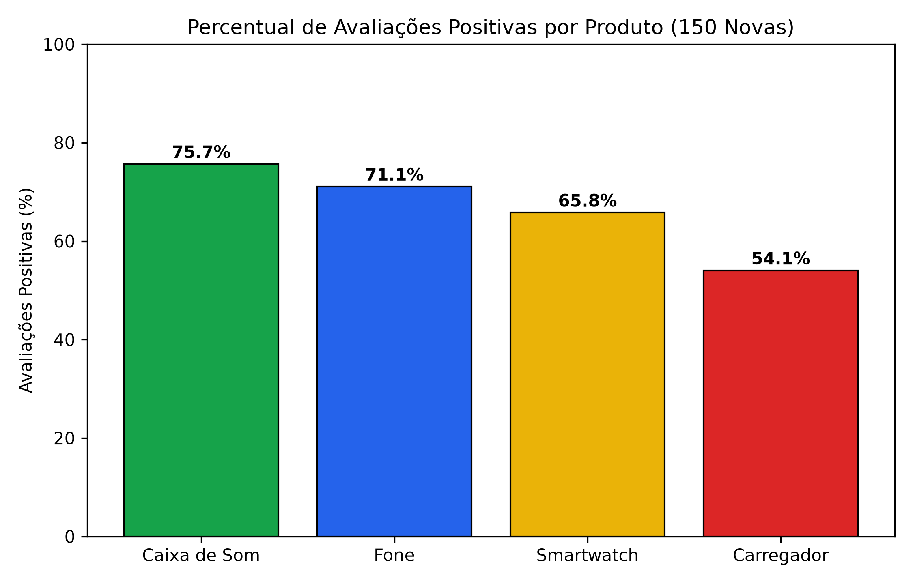
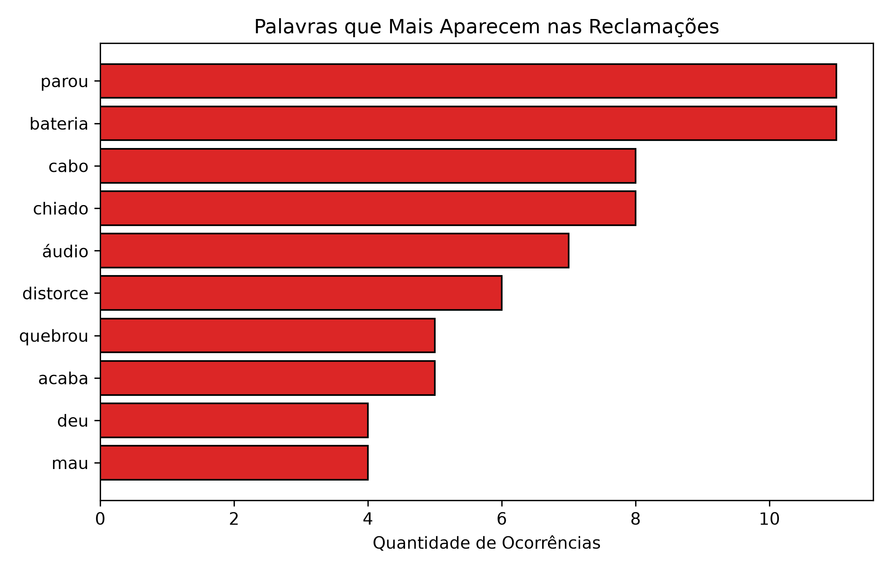
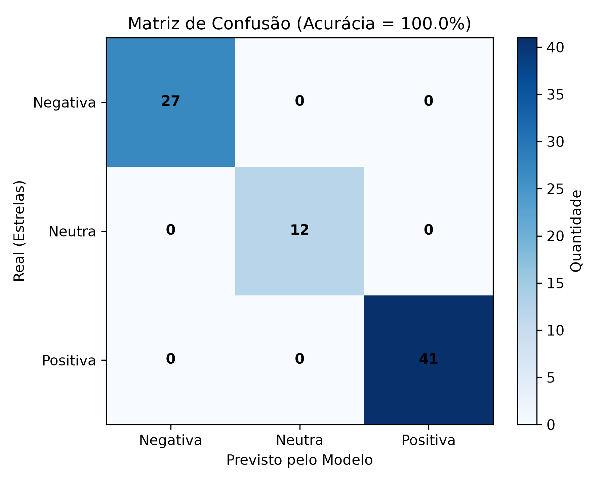

# Classificação de Avaliações da TechLoja com Machine Learning

**Disciplina:** Inteligência Artificial  
**Integrantes:** Rebeca Matewanga • Mariana Ocireu • Pablo de Sousa  
**Relatório para o Gerente:** [`relatorio_gerente.md`](relatorio_gerente.md)  

---

## 1. Cenário do Problema

A **TechLoja** vende quatro produtos: **Fone**, **Smartwatch**, **Caixa de Som** e **Carregador**.

1. **Treinamento ([`tabelas/avaliacoes_antigas.csv`](tabelas/avaliacoes_antigas.csv)):** O modelo é treinado com **400 avaliações antigas** que possuem nota em estrelas (`1` a `5`), divididas em 3 classes:
   - **Positiva:** 4 e 5 estrelas
   - **Neutra:** 3 estrelas
   - **Negativa (Reclamação):** 1 e 2 estrelas
2. **Aplicação ([`tabelas/avaliacoes_novas.csv`](tabelas/avaliacoes_novas.csv)):** O modelo treinado é aplicado em **150 avaliações novas** que possuem **apenas texto** (sem estrelas), gerando o arquivo [`tabelas/avaliacoes_novas_classificadas.csv`](tabelas/avaliacoes_novas_classificadas.csv) e montando o relatório para o gerente.

---

## 2. Modelo Utilizado e Como Executar

Foi utilizado um modelo leve, rápido e clássico para classificação de textos:
- **Vetorização:** `CountVectorizer` (Bag of Words)
- **Classificador:** `MultinomialNB` (Naive Bayes Multinomial)

### Executar o Projeto
```bash
pip install -r requirements.txt
python main.py
```

---

## 3. Relatório para o Gerente (150 Avaliações Novas)

### 3.1. Percentual de Avaliações Positivas de Cada Produto

| Produto | Total de Avaliações | Avaliações Positivas (%) | Neutras | Negativas (Reclamações) |
| :--- | :---: | :---: | :---: | :---: |
| **Caixa de Som** | 37 | **75.7%** (28) | 3 | 6 |
| **Fone** | 38 | **71.1%** (27) | 5 | 6 |
| **Smartwatch** | 38 | **65.8%** (25) | 5 | 8 |
| **Carregador** | 37 | **54.1%** (20) | 7 | **10** |
| **Total TechLoja** | **150** | **66.7%** (100) | **20** | **30** |

### 3.2. Palavras que Mais Aparecem nas Reclamações

Nas **30 avaliações classificadas como Negativas**, as palavras que mais se repetem são:

1. **`parou`** (11 vezes)
2. **`bateria`** (11 vezes)
3. **`cabo`** (8 vezes)
4. **`chiado`** (8 vezes)
5. **`áudio`** (7 vezes)
6. **`distorce`** (6 vezes)
7. **`quebrou`** (5 vezes)
8. **`acaba`** (5 vezes)

**Principais reclamações por produto:**
- **Fone:** `chiado` (5x), `bateria` (5x), `parou` (3x), `áudio` (3x)
- **Smartwatch:** `perde` (4x), `conexão` (4x), `aplicativo` (4x), `tela` (4x)
- **Caixa de Som:** `distorce` (6x), `volume` (4x), `áudio` (4x), `baixo` (3x)
- **Carregador:** `cabo` (8x), `parou` (8x), `mau contato` (4x)

---

## 4. Gráficos Gerados

### Percentual de Avaliações Positivas por Produto


### Palavras que Mais Aparecem nas Reclamações


### Matriz de Confusão do Modelo (Conjunto de Teste)

